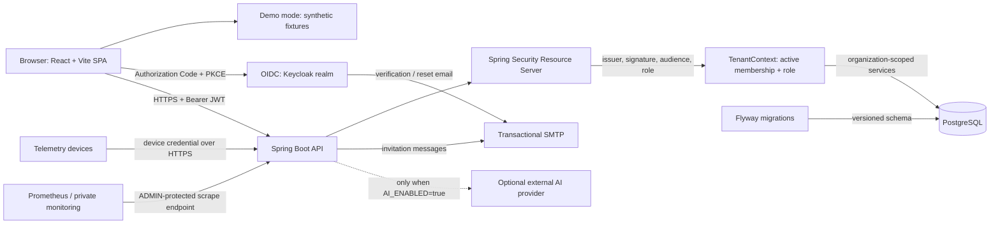

# WattScape Architecture

## System boundary

WattScape is a Vite/React single-page application with two intentionally separate operating modes:

- **Demo mode** uses clearly labelled synthetic frontend fixtures and does not silently write those fixtures to the live API.
- **Live mode** uses the backend API and Keycloak OIDC. It must be configured with HTTPS API and issuer origins; production builds do not fall back to a browser-local API.

The backend is a Java 21 / Spring Boot REST API. PostgreSQL is the system of record and Flyway owns schema evolution. Keycloak issues OIDC tokens; the API validates bearer JWTs and then checks active organization membership in its own database.

## Logical architecture

## Frontend

- Root build: `bun install --frozen-lockfile`, `bun run build`; Vite writes `dist/`.
- Development server: port 3000.
- Hosting config: `vercel.json` (Vite static output, SPA rewrite, security headers). `netlify.toml` and `public/_headers` are the alternate Netlify configuration.
- Public build-time variables: `VITE_WATSCAPE_API_BASE_URL`, `VITE_OIDC_AUTHORITY`, `VITE_OIDC_CLIENT_ID`. They are embedded in browser bundles; none may contain a secret.
- OIDC uses Authorization Code + PKCE (S256), with callback paths `/auth/callback` and `/auth/silent-callback`.
- The initial operating mode is Demo. Live mode must be deliberately selected and correctly configured.

## Backend API and authorization

- Root: `backend/`; build uses Java 21 and Spring Boot 3.5.x through Maven.
- Default application port: 8080 (overridable with `PORT`).
- API security is stateless bearer-token security. The resource server validates issuer/signature and audience; realm roles become Spring authorities.
- A selected organization header is not trusted as authorization by itself. `TenantContext` checks active membership for the token issuer and subject before returning the selected organization or role.
- Service methods further apply resource-scoped organization/site checks and business roles.
- CORS is an exact configured origin allowlist; credentials are disabled.
- Public health endpoints expose status, not component details. Prometheus and API documentation require ADMIN.

## Domain areas

The backend currently includes organization onboarding/invitations, sites/buildings/floors/rooms/assets, spatial floor-plan mappings and version history, telemetry device registration/ingestion/history, work orders/events, energy analytics, an optional AI insight gateway, and audit events.

PostgreSQL composite foreign keys and organization-qualified repository access support tenant scoping. The integration suite includes signed-JWT, tenant-isolation, telemetry-security, and scratch restore tests.

## Persistence and migrations

- Database engine: PostgreSQL 17.x in the local Compose and CI/Testcontainers setup.
- Runtime JDBC configuration: `DATABASE_URL`, `DATABASE_USERNAME`, `DATABASE_PASSWORD`.
- Hibernate schema behavior: `ddl-auto: validate`; it does not create/update production schema.
- Flyway is enabled at application startup and applies the ordered SQL files under `backend/src/main/resources/db/migration/` (currently V1–V6).
- Migrations are forward-only. Review and back up before every production startup that could apply a new migration.

## Identity and email

- Local Compose runs Keycloak in development mode with an embedded development database. It is strictly local-only.
- Production Keycloak has a separate optimized-image example and a PostgreSQL-backed configuration template under `deploy/keycloak/`.
- Keycloak realm email verification and password-reset email require a production SMTP configuration. The backend invitation sender also uses SMTP; Mailpit is local-only.
- Social identity providers are not configured in the production realm template.

## Operations and external integrations

- Backend health: `/actuator/health/liveness` and `/actuator/health/readiness`; readiness includes the database.
- Prometheus scrape: `/actuator/prometheus`, ADMIN-protected. Keep scrape access private.
- Telemetry ingestion uses a high-entropy per-device credential whose hash is stored server-side. The route is public at the JWT layer but validates that separate credential in the service; production edge rate limiting is still required.
- AI is disabled by default. When enabled, site-level aggregate metrics and the operator's question are sent to the configured external provider. Obtain data-handling approval before enabling it.

## Local versus production

The root `docker-compose.yml` is for local development and creates named PostgreSQL and Keycloak volumes. It must not be repurposed as a production deployment. Production requires separate managed PostgreSQL, production Keycloak, secret storage, authenticated SMTP, HTTPS hostnames, CORS/OIDC allowlists, backup/restore, monitoring, and explicit owner approval.

See [production deployment blueprint](PRODUCTION-DEPLOYMENT-BLUEPRINT.md), [operations runbook](OPERATIONS-RUNBOOK.md), and [production audit](PRODUCTION-AUDIT-2026-11-26.md).
