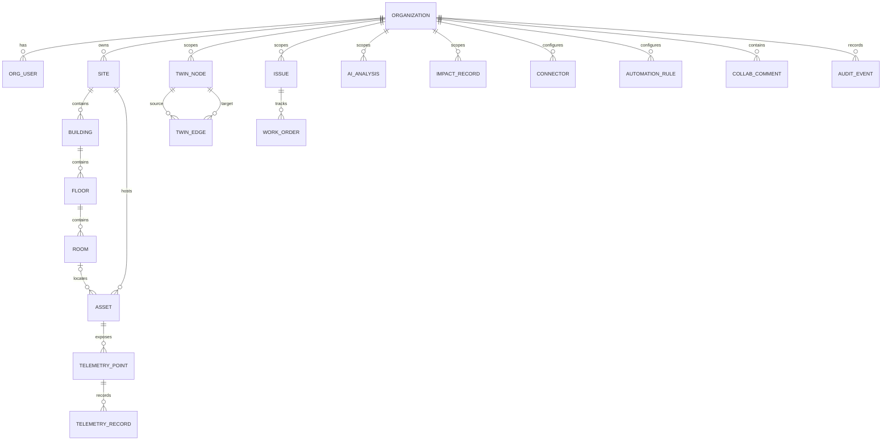

# WattScape Architecture Audit and Implementation Roadmap

**Review date:** 20 November 2026  
**Scope:** Static source audit of the supplied `wattscape-—-intelligent-3d-resource-twin-6.zip`. The archive was extracted to `work/wattscape` for inspection; no application files were changed. This is an architecture and security review, not a runtime verification.

## Executive summary

WattScape is a substantial React 19, TypeScript, and Vite product prototype with a distinctive 3D building twin, broad workflow coverage, rich synthetic fixtures, domain types, deterministic calculations, validation helpers, and calculation/validation test files. The project communicates demo boundaries in multiple screens and does not claim to be connected to live field hardware.

The platform is currently frontend-only. Its service boundary returns cloned in-memory demo fixtures, application state is held in React context, and sign-in is a persona selection that changes local UI state. There is no server, persistence, real identity provider, authorization enforcement, tenant isolation, telemetry ingestion, or Gemini request path. Many screens therefore demonstrate intended workflows rather than durable operations.

**Recommendation:** preserve the existing React experience and establish a versioned Spring Boot API and PostgreSQL persistence layer behind the current service boundary. Keep the current fixtures in a clearly isolated demo mode. Introduce backend capabilities in vertical slices, starting with identity/tenant boundaries and core building/asset data before telemetry, work management, AI, and integrations. Do not call the result production-ready until security, integration, and deployment checks are run against real infrastructure.

## Existing implementation

- **Frontend structure:** `src/App.tsx` routes among landing/auth screens and workspace screens. `src/components` contains layout, UI primitives, the landing visuals, and 2D/3D twin components. `src/views` groups portfolio, twin management, monitoring, work/collaboration, analytics/AI, simulation/impact, and administration screens.
- **Domain model:** `src/domain/types.ts` defines organization/member, site/floor/room, asset, twin graph, telemetry, issue/work order, scenarios, impact ledger, connectors, automation, AI response, emission factor, comments, and audit event contracts. Types encode useful distinctions such as observed/calculated/inferred provenance and unknown trust scores.
- **Demo data and state:** `src/data/demoData.ts` contains extensive synthetic tenant fixtures. `src/services/apiClient.ts` exposes `fetchInitialWorkspaceSnapshot()` but synchronously clones demo arrays; it has no HTTP transport. `WattScapeContext.tsx` owns most mutable state and mutation handlers.
- **Business logic:** `src/domain/calculations.ts` contains trust scoring, unit conversion, emissions, resource balance, and scenario modeling. `src/domain/graph.ts` contains graph/tenant consistency helpers. `src/domain/validation.ts` contains client-side validation and a control-request guardrail evaluator. Calculation and validation test files are present.
- **AI:** `AiQueryResponse` and curated AI presets exist, and the UI explains evidence and abstention. The Gemini dependency is declared, and the README mentions a Gemini key, but no source imports `@google/genai` or makes a Gemini request. AI responses are fixture-driven.
- **Security posture shown by code:** the UI describes OIDC/PKCE, RBAC, tenant isolation, and audit controls, but the observed implementation has no server-enforced identity, permissions, tenant filtering, secret boundary, or durable audit trail. No frontend Gemini secret usage was found in source.

## Key findings and risks

| Priority | Finding | Evidence and impact | Recommended direction |
|---|---|---|---|
| Critical | No backend or durable persistence | No Java/Maven project, server routes, repositories, migrations, or network API calls exist. Context mutations are in-memory and disappear on reload. | Build a Java 21+ Spring Boot service, PostgreSQL schema, Flyway migrations, and explicit API contracts. |
| Critical | Demo persona selection is not authentication | UI defaults to a named demo user; form validates email/role then `signInDemo` stores the submitted values in React state. No credential or token verification occurs. | Replace with OIDC/JWT-backed authentication. Keep persona selection only behind an explicit demo-mode switch. Enforce roles on every protected server operation. |
| Critical | Tenant isolation is only represented in fixture fields | `tenantId` appears in types, but there is no request identity or database policy. A client-provided tenant ID cannot be trusted as an authorization boundary. | Derive tenant scope from verified identity on the server; scope repository access and test cross-tenant denial. Consider PostgreSQL row-level security as defense in depth. |
| High | UI mutations imply operations without persistence | Room, asset, issue, work order, comments, and ledger actions update context arrays; they do not call a server. Audit events are generated in the browser. | Convert mutations to typed API commands with server validation, transactional persistence, authorization, and durable audit events. Add clear pending/error/success states. |
| High | Simulated analytics include hard-coded values | Analytics resource balance uses literal constants, while demo fixtures hold separate sample values. This can produce values that do not follow the selected site/window. | Move calculations to reusable services over selected, provenance-tagged inputs; return formula, period, units, data coverage, and provenance with results. Keep model assumptions explicit. |
| High | “Audit hash” values are random placeholders | Context generates random strings prefixed `sha256:` rather than hashes of canonical event content. They are not tamper evidence. | Generate canonical, append-only audit records server-side; use cryptographic hashes/signatures only with a documented chain and key lifecycle. Do not describe random IDs as hashes. |
| High | Control guardrail is client-side demo logic | The guardrail evaluator can make a UI decision but is not enforced by a trusted system. No live connector exists, which the UI does disclose. | Keep actuation disabled until server-side allow-list, bounds, approval workflow, idempotency, connector auth, and immutable command/result audit are implemented. |
| Medium | Existing validation is limited to frontend workflows | Helpers validate basic email shape, selected work-order/room fields, CSV splitting, and demo control bounds. CSV parsing is comma-split and does not support escaped delimiters/quotes; there is no server-side validation. | Use Bean Validation and domain invariants in API commands. Adopt a correct CSV parser and enforce uniqueness/references/limits in database transactions. |
| Medium | API/error/loading conventions do not exist yet | The snapshot API is synchronous and no HTTP, cancellation, retry, or error model is present. | Add a typed client with versioned routes, request IDs, consistent problem responses, auth handling, and screen-level loading/empty/error states. |
| Medium | Dependency/configuration and delivery baseline is prototype-level | Package name remains `react-example`; README is AI Studio oriented; no backend/container/CI deployment configuration is included. `@google/genai`, Express, and dotenv are declared but unused in inspected source. | Reconcile dependencies, document local/dev/prod profiles, containerize app and API, and add automated build/security pipelines after requirements are agreed. |
| Medium | Data lifecycle and scaling are undefined | Telemetry types and fixtures exist, but there is no ingestion protocol, retention/partitioning strategy, aggregation store, or paging contract. A single relational store may be inefficient for high-volume samples. | Use PostgreSQL for operational entities and bounded/queryable telemetry initially; define volume targets before deciding on TimescaleDB or a separate time-series store. Partition and aggregate by measured workload. |

## Recommended target architecture

Use a modular monolith first, with explicit module boundaries and a later extraction path if scale requires it:

- **React/Vite client:** preserve current screens and domain vocabulary; support separate demo and connected modes. Keep Gemini keys and database credentials out of browser bundles.
- **Spring Boot API (Java 21):** versioned REST `/api/v1`; controller, application service, domain, repository, and infrastructure packages. Spring Security resource-server JWT validation; Bean Validation; centralized problem-details errors; OpenAPI; structured logs with request/correlation IDs.
- **PostgreSQL:** normalized operational records, tenant-scoped foreign keys, indexes, and Flyway migrations. Use transactions for multi-record mutations and append-only audit records. Store secrets outside the database where possible; persist connector secret references rather than credentials.
- **AI gateway module:** server-side Gemini client, timeout/retry/rate controls, strict response schema validation, provenance/evidence packet, confidence and abstention fields, model/prompt version, and audit record. Treat generated output as inference; never represent it as observed telemetry or verified savings.
- **Integration boundary:** connector interfaces and ingestion jobs with source identity, idempotency, timestamps, units, mapping, and quality state. No real hardware integration should be claimed until a connector is configured and exercised.
- **Operations:** Docker Compose for local API + PostgreSQL, environment-based configuration, health/readiness endpoints, backup/restore procedure, migration strategy, and CI checks.

### Suggested core relational model

Every tenant-owned row should carry `organization_id`; foreign keys should prevent cross-tenant relations (composite tenant-aware keys or equivalent enforced service/database constraints). Avoid putting large, unbounded telemetry history in aggregate JSON fields. Add uniqueness constraints for organization-scoped identifiers and indexes around tenant + site + time/query dimensions.

## Proposed API surface (initial contract map)

All routes below are proposed, not implemented. Require authenticated tenant context except login/health/docs as configured.

| Area | Initial endpoints |
|---|---|
| Identity | `GET /api/v1/me`, `GET /api/v1/organizations/current`, `GET /api/v1/organizations/current/members` |
| Sites/twin | `GET/POST /api/v1/sites`; `GET /api/v1/sites/{siteId}/twin`; `GET/POST /api/v1/sites/{siteId}/rooms`; `GET/POST /api/v1/sites/{siteId}/assets` |
| Telemetry/quality | `GET /api/v1/sites/{siteId}/telemetry?from=&to=&metric=`; `GET /api/v1/sites/{siteId}/quality`; ingestion endpoint restricted to connector/service identity |
| Operations | `GET/POST /api/v1/issues`; `GET/POST /api/v1/work-orders`; `POST /api/v1/work-orders/{id}/transitions`; comments under scoped resources |
| Analytics/impact | `GET /api/v1/sites/{siteId}/analytics/resource-balance`; `POST /api/v1/scenarios`; `GET/POST /api/v1/impact-records` with explicit review/verify transitions |
| AI | `POST /api/v1/ai/analyses` with question + bounded scope; `GET /api/v1/ai/analyses/{analysisId}` |
| Administration | connector/rule CRUD behind admin roles; audit query read-only and access-controlled |

Use cursor or bounded time-window pagination for potentially large telemetry and audit queries. Mutations should accept idempotency keys where clients may safely retry.

## Implementation roadmap

1. **Confirm this audit and boundaries.** Resolve deployment target, identity provider, expected tenants/users, telemetry volume/retention, and whether a non-production demo login must remain.
2. **Establish backend skeleton and contracts.** Java 21, Spring Boot, Maven, API v1 conventions, OpenAPI, errors, configuration profiles, logging, health endpoints, and Compose PostgreSQL.
3. **Implement identity, tenant, and core master data.** Organizations, roles, sites/buildings/floors/rooms/assets, migrations, authorization tests, and frontend authentication/snapshot integration. Preserve demo mode separately.
4. **Implement operational data and work flows.** Twin graph, telemetry/quality records, issues, work orders, collaboration, audit trail; add server validation and UI loading/error states.
5. **Implement analytics and sustainability.** Port/define formulas, version emission factors, scenario assumptions, observed/calculated/inferred distinctions, impact review lifecycle, and reproducible evidence.
6. **Implement Gemini AI safely.** Server-side provider adapter, validated structured outputs, evidence references, confidence/abstention, provenance, rate limits, auditability, and frontend AI integration. No direct actuation from model output.
7. **Add connector and automation framework.** Interfaces, secret references, inbound ingestion, rule evaluation, human approval and command audit. Activate real integrations only with a verified external system and explicit configuration.
8. **Quality and deployment hardening.** Unit/integration/API/database/frontend checks, security/dependency scanning, backup/restore rehearsal, production build, deployment docs, and final readiness report. Report any checks not executable in the available environment.

## Review limits and next gate

This audit is based on source inspection of the supplied archive. It does not establish runtime behavior, dependency vulnerability status, exploitability, performance, or production readiness. Existing test files were noted but were not run during this audit. No frontend/backend architecture changes have been made.

The next step is the implementation phase described above, beginning with agreed identity, deployment, and telemetry assumptions. The React UI and its demo fixtures should remain intact while connected mode is introduced incrementally.
