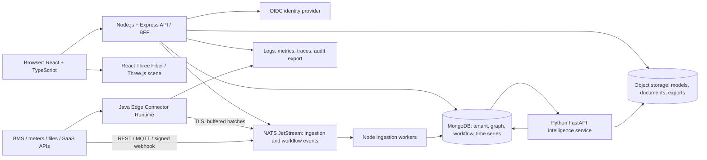

# WattScape
## Product Requirements and Technical Specification

**Document status:** Product architecture baseline, draft 1.0  
**Research reviewed:** 20 November 2026  
**Audience:** Product, design, engineering, AI, operations, implementation partners  
**Purpose:** A build-ready brief for Google AI Studio and Claude Code. This document specifies product behavior and system boundaries; it is not permission to generate the full application code.

---

## 1. Executive product definition

WattScape is a multi-tenant operational intelligence platform for organizations that manage buildings, campuses, equipment, and portfolios. It joins spatial context, physical assets, utility and sensor data, work activity, sustainability factors, and decision evidence in a navigable 3D resource twin.

The product must turn messy, differently shaped source data into a useful operating model. A user should be able to start without BIM, improve the model as better evidence arrives, see where a condition exists, understand why a recommendation was made, test resource trade-offs, assign a safe action, and later check whether the outcome occurred.

WattScape is **not** a generic dashboard with a 3D scene attached. The twin is the workspace and shared context for monitoring, analysis, maintenance, simulation, and proof of outcomes. A 2D equivalent remains available for accessibility, low-bandwidth environments, and tasks where a spatial scene adds no value.

### 1.1 Product outcome

For each monitored site, WattScape should make it possible to answer:

1. What spaces, assets, meters, and systems are here, and how are they related?
2. What resources are entering, being used, stored, lost, or emitted?
3. Which readings and calculated results can be trusted, and why?
4. Where is the operational issue, what context explains it, and what is the safe next action?
5. What would change under a proposed intervention, with what cost, carbon, comfort, and reliability trade-offs?
6. What was actually done, what changed afterward, and what evidence supports the claimed impact?

### 1.2 Product principles

- **Spatial context first:** every significant meter, signal, event, task, and result can resolve to a site, space, asset, or an explicitly unlocated state.
- **Start with what exists:** a useful twin can be created from a guided survey, a floor plan, room list, asset list, and meter data. BIM is an enrichment path, not an entry requirement.
- **Show evidence with every answer:** preserve source, timestamp, unit, transformation, quality state, and calculation version.
- **One model, many views:** monitoring, maintenance, analytics, sustainability, and simulation read from a shared resource graph.
- **Recommend before controlling:** AI recommendations are reviewable; physical control is gated by explicit permissions, constraints, and approval policy.
- **Separate forecast from result:** modeled savings, observed changes, and verified impacts use distinct labels and data lineage.
- **Works when data is imperfect:** gaps, estimates, stale feeds, confidence, and unresolved mappings are visible instead of silently filled.
- **Interoperable by design:** source identifiers and semantics remain traceable; the canonical model does not erase vendor context.

### 1.3 Target users and jobs

| User | Primary job in WattScape |
|---|---|
| Portfolio owner / executive | Compare sites, allocate investment, review risk and verified performance. |
| Facilities / building operator | Find a live issue, inspect its location and equipment, diagnose context, and coordinate a response. |
| Energy / resource manager | Reconcile bills and meters, track consumption and spend, find abnormal use, and verify projects. |
| Sustainability lead | Maintain emissions factors and reporting boundaries, track resource targets, and assemble traceable evidence. |
| Maintenance planner / technician | Locate equipment, inspect history and documents, receive tasks, record work, and close the loop. |
| Twin / integration administrator | Set up sites, map spaces and assets, connect source systems, review data quality, and govern access. |
| Analyst / consultant | Explore trends, compare scenarios, prepare evidence packs, and share scoped findings. |

### 1.4 Initial scope boundary

The first release is an operational intelligence and decision-support product. It is not a replacement for a certified BMS, life-safety control system, computerized maintenance management system, utility settlement platform, or statutory carbon accounting assurance engagement. Integrations may read from those systems and create approved work or control requests, but source systems remain authoritative for their own execution records.

---

## 2. Competitor research and market baseline

### 2.1 Method and limits

This scan reviews public vendor documentation and official program pages for the named products. It records capabilities the vendors publicly describe; it does not independently test products, validate vendor performance claims, or establish customer satisfaction. Feature availability may differ by market, product edition, deployment, configuration, and contract.

Pain points below are marked as **documented signal** when vendor material directly presents a task such as bill auditing or BIM handover, and **inference** when the issue follows from the technical shape of the product category. They are not presented as customer interview findings. The opportunity statements are product hypotheses to validate with operators and buyers. No market share, savings, adoption, or customer evidence is asserted.

### 2.2 Named platform capability map

| Platform | Publicly documented capability pattern | Relevance to WattScape / evidence |
|---|---|---|
| **Autodesk Tandem** | BIM-oriented building twin creation; facility templates and classifications; 3D model context with charts and heatmaps; asset inventory and documentation; near-real-time and historical streams; sensor/BMS integrations and APIs; spatial links among systems, floors, rooms, and assets; handover workflows. Autodesk describes Revit-based workflows and data-rich twin operations. | Treat 3D heatmaps, sensor streams, asset inventory, data APIs, and model handover as established market capabilities. Its feature material emphasizes BIM data and says twin quality depends on accurate BIM; that supports a no-BIM onboarding hypothesis, not a claim that Tandem cannot be used without BIM. [Autodesk Tandem features](https://intandem.autodesk.com/features/) |
| **Willow** | A building knowledge graph for assets, systems, spaces, and relationships; spatial geometry with live data; historical, real-time, and forecast time series; calculated/virtual time series; analytics and automation capabilities. | A resource graph, 3D spatial context, telemetry, forecasting, and automation are already represented in the market. WattScape must differentiate through its workflow and evidence model, not by claiming these concepts alone are new. [Willow digital twin](https://willowinc.com/willow-digital-twin/) · [Willow developer resource guide](https://developers.willowinc.com/docs/resource-guide-digital-twin) |
| **Siemens Building X — Lifecycle Twin** | BIM-based building twin creation and maintenance; 3D model inspection; room/asset data and relationship diagrams; preventive maintenance support; issues, work orders, and location markup attached to model locations. Other Building X apps cover energy monitoring and operations management. | Asset lifecycle, issue/work-order context, and operational twin views are established functionality. Public documentation describes Lifecycle Twin as based on BIM, which informs a low-friction, non-BIM entry opportunity. [Lifecycle Twin](https://www.siemens.com/en-us/products/building-x/applications/lifecycle-twin/) |
| **Schneider Electric EcoStruxure Building Operation** | Building management and control center for multiple building systems; open integration across Schneider and third-party energy, lighting, HVAC, fire, security, IWMS, meters, WAGES, EV charging, and renewables; dashboards and charts; semantic tagging with Brick Schema. | Multi-vendor integration, visualization, BMS monitoring, and semantic tagging are established. WattScape should complement BMS control and avoid implying that an integration hub by itself is differentiated. [EcoStruxure Building Operation](https://www.se.com/ww/en/work/products/product-launch/building-management-system/) |
| **Johnson Controls OpenBlue Enterprise Manager** | Public product documentation describes equipment performance and operations efficiency features, including asset health/utilization monitoring, custom integrations to building subsystems, fault detection and diagnostics, and energy-savings opportunities. | FDD, asset health, and equipment monitoring are established categories. WattScape should provide transparent evidence, spatial context, and cross-resource action tracking around findings rather than claim anomaly detection as unique. [OpenBlue equipment performance and operations efficiency](https://docs.johnsoncontrols.com/bas/r/OpenBlue/en-US/OpenBlue-Enterprise-Manager-Catalog-Page/6.4/Features/Equipment-Performance-and-Operations-Efficiency?contentId=PiqW9iXlczkesA5XidhHWg) |
| **BrainBox AI** | HVAC-focused autonomous optimization; ARIA virtual building engineer for building data visualization, recommendations, schedule/setpoint tasks, and building-management questions; vendor material describes live data and action capabilities. | AI-assisted building operations, conversational analysis, optimization, and control are already in market. WattScape's defensible design target is explainability, cross-resource trade-offs, explicit controls, and proof lineage—not “AI for buildings.” [ARIA](https://brainboxai.com/en/aria-your-building-ai-engineer) · [Cloud BMS and ARIA announcement](https://brainboxai.com/en/newsroom/brainbox-ais-cloud-building-management-system-and-award-winning-ai-agent-aria-unite-at-ahr-2025) |
| **EnergyCAP** | Utility bill and energy data management; bill capture, validation and auditing; portfolio reporting and benchmarking; interval-data analytics; emissions; ENERGY STAR Portfolio Manager integration; anomaly/exception workflows; plain-language AI chat. | Utility cost control, bill QA, benchmarking, emissions, and AI-assisted analysis are established. WattScape should interoperate with bill systems and link resource results to physical location and interventions. [Utility and energy management](https://www.energycap.com/utility-bill-energy-management-software/) · [Feature catalog](https://www.energycap.com/utility-bill-energy-management-software/features/) |
| **EnergyElephant** | Vendor-published material describes collection and analysis of utility, meter, fuel, water, waste, and carbon data; baselines and targets; multi-resource tracking; sustainability reporting and project/ROI tracking. Public product material also describes bill/invoice ingestion and manual meter capture workflows. | Multi-resource and carbon coverage is already a market capability. WattScape's 3D spatial graph and operational response loop must complement, not re-label, multi-resource dashboards as unique. This capability summary is from the vendor's own published comparison article, not independent verification. [EnergyElephant product comparison article](https://blog.energyelephant.com/best-energy-management-carbon-reporting-software-2026/) |
| **ENERGY STAR Portfolio Manager** | U.S. EPA-hosted property benchmarking and tracking; energy, water, waste/materials, and emissions metrics; comparisons against baselines and eligible peer/reference values; performance documents and custom reports; REST-based web services for exchange. | Benchmarking, resource tracking, score/report workflows, and APIs are established. WattScape should treat Portfolio Manager as an integration/reporting endpoint where applicable, not recreate or claim to replace its authoritative benchmarking calculations. [Benchmarking](https://www.energystar.gov/buildings/benchmark) · [Web services](https://www.energystar.gov/buildings/resources-audience/service-product-providers/existing-buildings/benchmarking-clients/use-pm-web-services) |

### 2.3 Functionality recurring in the sampled market

These are recurring patterns in the named sample, not a claim that every vendor offers every item:

- Facility, space, system, and asset hierarchies with source integrations.
- Portfolio or site level views for energy and operational performance.
- Utility, meter, or sensor data ingestion, historical analysis, and reporting.
- Asset health, fault/anomaly, maintenance, or operational response workflows in building-operations products.
- Benchmarking, billing, emissions, and sustainability workflows in resource-management products.
- Spatial/3D context in digital-twin products; it is not common to all resource platforms.
- AI recommendations or optimization in a subset of building AI platforms; autonomous control is not a universal expectation.
- External APIs and data exchange; integration effort and supported source combinations vary.

### 2.4 Pain points, constraints, and opportunities

| Issue | Evidence status | Product implication |
|---|---|---|
| Twin creation can depend on suitable BIM or structured handover data. | **Documented signal:** Autodesk describes Revit/BIM workflows and Siemens describes Lifecycle Twin as BIM-based. The vendors also describe ingestion, templates, and handover processes. This does not prove that all deployments require BIM. | Make Zero-BIM onboarding a first-class path; import BIM as an optional higher-fidelity source; show how source quality affects geometry and insights. |
| Utility bill, meter, BMS, sensor, asset, and sustainability data live in different systems and shapes. | **Vendor positioning signal:** multiple vendors foreground integrations, centralization, validation, and shared data. This is not independent evidence of customer pain prevalence. | Build a canonical model with source-preserving mappings and reusable connector templates. |
| Data quality and semantics are prerequisites for useful analysis. | **Documented signal:** EnergyCAP describes bill auditing and validation; Autodesk describes progress boards for missing twin data; Schneider describes semantic tagging. | Create a Data Trust Engine that reports quality at field, point, asset, and site level, including lineage and human correction paths. |
| Spatial context is not enough when the 3D model is absent, incomplete, or expensive to maintain. | **Inference** from BIM-centric twin workflows and the need to keep source models aligned with changed spaces and assets. | Support sketch/plan-derived geometry, confidence labels, corrections, and incremental asset reconciliation. |
| Analytics often stops at a finding or recommendation; connecting it to approved work and observed results requires cross-system coordination. | **Inference** from the separate product categories and integrations reviewed. Do not claim that competitors cannot perform this workflow. | Model a full issue → evidence → decision → action → measurement → review lifecycle with APIs and export. |
| AI recommendations and physical control require different safety and evidence levels. | **Inference** from products that offer both AI analysis and setpoint/schedule execution. | Enforce explicit actuation scopes, guardrails, approvals, command acknowledgements, rollback, and audit records. |
| Savings and carbon results depend on baselines, operational context, and factor versions. | **Inference** from utility benchmarking and emissions calculation workflows. | Separate modeled, observed, and reviewed outcomes; preserve baseline choices and emissions-factor versions. |

### 2.5 Differentiation hypotheses, with market overlap stated

The eight ideas below are product bets, not proven unique features. Similar building blocks already appear in the cited market. “Differentiated” means WattScape intends to combine them into a cohesive product workflow; it does not mean no competitor has a comparable feature.

| WattScape concept | Existing overlap | Proposed difference to validate |
|---|---|---|
| **Zero-BIM Resource Twin Creator** | BIM-to-twin, templates, geometry, and handover exist in Autodesk Tandem and Siemens Lifecycle Twin; Willow provides spatial geometry. | Create a usable, explicitly lower-confidence spatial resource model from room lists, floor-plan imagery/PDF/SVG, guided dimensions, and asset CSVs, then progressively reconcile it with BIM and measured data. Validate setup time and correction burden with operators who lack current BIM. |
| **Unified Spatial Resource Graph** | Willow documents a knowledge graph; Tandem and Siemens connect objects spatially; semantic building models exist. | One tenant-scoped, source-preserving graph links spaces, systems, meters, readings, resource flows, work orders, scenarios, and proof records across the full WattScape workflow. Validate whether users benefit from cross-domain joins that their existing toolchain does not provide. |
| **Data Trust Engine** | Bill audits, data validation, missing-data boards, and semantic tagging exist. | Per-value trust state, provenance, freshness, coverage, unit conversion, uncertainty, and downstream impact propagation are visible for every critical metric. Validate that a shared, explainable trust model reduces reconciliation work. |
| **Explainable Resource AI** | ARIA, Watts AI, fault detection, forecasts, and optimizers are already marketed. | Every answer/recommendation shows evidence links, assumptions, quality caveats, confidence, counterfactual, and allowed next action; abstains when evidence is weak. Validate explainability and calibrated abstention with facilities and sustainability teams. |
| **Resource Trade-off Simulator** | Building optimization, predictive trends, benchmarking, and ROI analysis exist. | Compare interventions across energy, water, waste, cost, carbon, comfort, and reliability in one scenario model, with uncertainty and a Pareto view. Validate which trade-offs actually change investment decisions. |
| **Problem-to-Proof Engine** | Vendors offer issues/work orders, project tracking, savings analytics, and reporting. | Tie a problem, evidence snapshot, approved intervention, baseline, measured result, reviewer, and exportable proof packet into one auditable lifecycle. Validate usefulness with energy project owners and finance reviewers. |
| **Operational Context Engine** | Graphs, spatial context, FDD, and schedules exist. | Explain an event by joining equipment topology, room/occupancy schedule, weather, work history, resource data, and relevant policies while showing which context is observed versus inferred. Validate relevance and false-correlation risk. |
| **Verified Impact Ledger** | Energy savings, emissions accounting, and ROI/reporting features exist. | Preserve immutable, versioned evidence for modeled versus measured impact, calculation factors, adjustments, reviewer attestations, and reversals. Do not label an outcome “verified” until policy checks pass. Validate accepted review rules with customers and auditors. |

---

## 3. Product scope and functional requirements

### 3.1 Priority definitions

- **P0 — MVP:** required to prove the end-to-end operating loop for a small portfolio.
- **P1 — Advanced:** required to broaden resource coverage, intelligence, and workflow automation.
- **P2 — Enterprise:** required for large organizations, complex governance, and regulated procurement.

### 3.2 Organization management

**P0 requirements**

- Create an organization with name, legal/display identity, home currency, time zone policy, default unit system, locale, and data-retention settings.
- Invite users by email; support acceptance, expiry, revoke, and resend.
- Organize sites in a portfolio hierarchy with tags and optional regional groupings.
- Configure users with organization-wide or scoped site access.
- Keep all records tenant-scoped; organization identifiers are derived from the authenticated session, never trusted from the request body.

**P1/P2**

- Organization templates, delegated administration, guest access with expiration, bulk provisioning, SSO, SCIM, and data residency selection.
- Separate business units and service providers with explicit ownership and visibility boundaries.

### 3.3 Digital Twin Builder

**P0 requirements**

- Create a site through a guided setup wizard: address/time zone, building type, area/units, floors, spaces, primary meters, and known systems.
- Accept a room list and asset/meter CSV with downloadable templates, validation preview, duplicate detection, mapping, and error file.
- Accept floor-plan image, PDF, SVG, and IFC input; preserve source file and import version. BIM import enriches the twin but is not required to create one.
- Provide manual floor/room drawing, polygon editing, room naming, adjacency editing, and floor stacking. Generated geometry must be labeled “estimated” until reviewed.
- Link spaces, assets, systems, meters, and source identifiers. Allow a sensor or meter to be unlocated while a user resolves it.
- Show model completeness and unresolved mapping counts; never imply geometry, identity, or relationships are verified if inferred.
- Support revision history, import comparison, undo for the current edit session, and conflict review for re-imported sources.

**P1/P2**

- Guided mobile site survey with photos and QR/barcode capture; point-cloud processing; federated IFC/BIM coordination; version-to-version change detection; reusable templates; controlled handover.

### 3.4 Asset management

**P0**

- Create asset records with asset class, name, manufacturer/model/serial where known, location, parent system, install/commission dates, status, criticality, owner, documents, and source IDs.
- Browse/search/filter by site, floor, room, system, category, status, criticality, and trust state.
- Show readings, related alarms, work orders, inspections, scenarios, documents, and model position from one asset page.
- Import, export, bulk edit, and merge duplicates with a preserved merge record.

**P1/P2**

- QR/barcode scan, parts and warranties, condition/risk scores, lifecycle plans, vendor/contract records, and CMMS synchronization.

### 3.5 Multi-resource monitoring

**P0**

- Track electricity, fuel, thermal energy, renewable generation/storage, demand, and utility cost.
- Ingest water volume by source and meter, detect abnormal continuous use and meter gaps, and track water cost if supplied.
- Ingest waste weight/volume, stream/category, destination, diversion status, and cost when supplied; preserve source units and conversion.
- Calculate operational GHG emissions from configured activity data and versioned emission factors. Record scopes/categories as the organization configures them; do not assume a factor or boundary silently.
- Represent indoor environmental conditions such as temperature, humidity, CO₂, and particulate matter as optional signals, not mandatory fields.
- Expose actual, estimated, calculated, forecast, and missing values distinctly.
- Provide current status, historical trend, baseline comparison, site/portfolio roll-up, and drill-through to source readings.

**P1/P2**

- Demand response, tariff/rate schedule analysis, storage/renewables dispatch modeling, tenant allocations, procurement, and additional resource types.

### 3.6 Integration Hub

**P0**

- Register each integration as a connector instance with source system, site scope, credential reference, health, sync mode, last successful sync, and data owner.
- Start with secure file import (CSV/XLSX), REST webhook/API, MQTT, and a Java edge connector framework for protocol adapters.
- Provide canonical field mapping, point discovery, units, time zone, sample preview, validation, and dry-run before activation.
- Keep the source key and raw source payload reference for each imported record where policy allows.
- Provide connection status, lag, rejected records, retry history, and actionable remediation instructions.
- Support idempotent replays and connector-specific rate limits.

**P1/P2 connector candidates**

- BACnet/IP, Modbus TCP/RTU via edge gateway, OPC UA, common BMS APIs, CMMS/work-order systems, ENERGY STAR Portfolio Manager web services, utility Green Button or supplier APIs where available, and SSO/SCIM. Connector availability must be verified per vendor, region, protocol, and contract before it is promised.

### 3.7 Data Intelligence

**P0**

- Map source data to canonical properties with typed units and temporal semantics.
- Detect missing intervals, stale values, duplicate messages, impossible ranges, unit mismatches, clock drift, and source changes.
- Keep original source value, normalized value, conversion formula/version, event time, ingestion time, source system, and correction history.
- Provide a review queue for uncertain asset identity, point mapping, anomaly, and factor mapping.
- Let an authorized user confirm, reject, or correct a mapping; store actor, reason, previous value, and time.
- Propagate trust degradation to derived metrics and recommendations.

### 3.8 Analytics

**P0**

- Portfolio → site → building → floor → room → asset drill-down.
- Time-series charts with aggregation, unit, time zone, baseline, comparison period, and data-quality overlay.
- Resource balance views for measured inputs, generation, consumption, and known losses; display an explicit “unaccounted” balance when meters do not reconcile.
- Benchmark only like-for-like, supported metrics. Display boundary, normalization inputs, period, source, and limitations.
- Saved views, filters, annotations, and exports (CSV/PDF) with scope and generation timestamp.

**P1/P2**

- Forecasts, cost and tariff analysis, load shapes, normalized weather/occupancy comparisons, scenario overlays, portfolio ranking, and governed external benchmarking.

### 3.9 AI Intelligence

**P0**

- Provide evidence-backed natural-language search over the user's authorized twin records, readings, documents, and work history.
- Generate anomaly explanations and recommendations with citations to source records, observed periods, assumptions, trust states, and confidence/uncertainty.
- Include “why this answer,” “what could change it,” and “show underlying data” affordances.
- Abstain or ask a bounded follow-up when the question cannot be answered from authorized evidence.
- Do not train shared models on tenant content by default; tenant data handling and model-provider terms are explicit configuration/contract controls.
- Do not let a language model execute a building command directly. AI proposes a typed action request to the policy engine.

**P1/P2**

- Equipment-specific forecasting, anomaly models, causal/context ranking, policy-aware recommendation ranking, natural-language report drafting, and tenant-approved fine-tuning where separately governed.

### 3.10 Automation Studio

**P1**

- Visual, typed workflow builder with trigger → conditions → actions → approvals → outcomes.
- Trigger types: threshold, missing data, anomaly candidate, schedule, work-order state, scenario review, and verified-impact review.
- Actions: notify, create task, request approval, create work order, update a permitted metadata field, or request a control change through a registered integration.
- Every rule has owner, version, enabled state, scope, test mode, sample preview, retry policy, rate cap, and audit record.
- Prevent loops, duplicate tasks, unbounded fan-out, and actions outside a user's authority.
- Physical-control requests require allow-listed point, min/max, rate-of-change, expiry, approval policy, and source-system acknowledgement; safe failure is to reject/hold, not improvise.

### 3.11 Simulation Laboratory

**P1**

- Create a named scenario from a baseline period and an explicit system boundary.
- Change one or more assumptions: schedules, setpoints, equipment efficiency, envelope/occupancy assumptions, renewable capacity, water strategy, waste diversion, utility rate, or carbon factor.
- Report predicted resource, cost, carbon, comfort, reliability, capex, and payback effects where inputs exist.
- Show input coverage, assumptions, uncertainty range, model version, and unsupported effects.
- Compare multiple scenarios; support constraints and Pareto-style views for competing objectives.
- Never write scenario values back to live equipment. “Apply” creates an approved action plan, not direct actuation.

### 3.12 Maintenance

**P0**

- Create/assign work items manually from a site, asset, issue, or alert.
- Track status, severity, assignee, due date, evidence, notes, linked reading, photos/documents, and closure code.
- Display work items spatially and in a board/list for users who do not use 3D.
- Keep external work-order IDs and synchronization outcomes when connected to a CMMS.

**P1/P2**

- Recurring preventive maintenance, inspections, technician mobile workflow, parts/warranty, SLA views, condition-based schedules, and CMMS bidirectional synchronization.

### 3.13 Sustainability

**P0**

- Track energy, water, waste, and emissions against explicit organizational/site boundaries and target periods.
- Store factor source, region, vintage, unit, applicability, and calculation version. Recalculation creates a new result version, never silently overwrites a submitted result.
- Show actual vs estimated activity data, market/location factor choice where configured, and completeness.
- Create an evidence-backed report export and map supported property information to ENERGY STAR Portfolio Manager where applicable.

**P1/P2**

- Target libraries, project tracking, renewable attributes, supplier data, expanded GHG categories, formal disclosure mappings, and review workflows. Reporting standards and jurisdictional requirements must be configured and reviewed separately; no automatic compliance assertion is made.

### 3.14 3D visualization and navigation

**P0**

- Render a site/building/floor/room/asset scene in an interactive WebGL view.
- Support orbit, pan, zoom, selection, isolate, hide/show, floor cutaway, accessible object list, and fit-to-selection.
- Bind heatmaps to a selected metric and time window; show a legend, missing-data state, unit, and selected object value.
- Highlight data-quality and issue states without relying on color alone.
- Provide focus mode for an asset with metadata, history, documents, alarms, and linked work items.
- Persist named camera states and shared links with permission-scoped data.

### 3.15 Collaboration

**P0**

- Comments and annotations anchored to an asset, room, issue, scenario, or report; mention users and show edit history.
- Share saved views internally with scoped access; provide exportable evidence packets.
- Notifications are configurable by event type, site, user role, quiet window, and delivery channel.

**P1/P2**

- Approval chains, review tasks, external consultant access, team workspaces, and co-review sessions.

---

## 4. Eight core differentiating systems: detailed behavior

### 4.1 Zero-BIM Resource Twin Creator

**Inputs:** guided building form; room/asset/meter CSV; floor-plan PDF/SVG/image; operator-entered dimensions; optional BIM/IFC; optional photos and QR codes.  
**Pipeline:** inspect files → extract candidate floors/rooms/labels → propose geometry/topology → let operator review → attach assets/meters → publish a versioned model.  
**Outputs:** spaces, adjacency, approximate geometry, resource locations, source references, and confidence labels.

Requirements:

- Generate geometry only from explicit source material or user-confirmed dimensions; label inferred scale and boundaries.
- Ask the user to resolve ambiguous floor count, room boundary, scale, orientation, and duplicate labels.
- Maintain distinct states: `draft`, `needs_review`, `reviewed`, and `superseded`.
- Give each generated property a provenance record and confidence reason.
- Allow later IFC/BIM reconciliation without replacing user edits silently.
- Acceptance: an administrator can create a one-floor, 20-room twin from a plan plus room list, correct proposed boundaries, place five assets, and publish a reviewable model without uploading BIM.

### 4.2 Unified Spatial Resource Graph

**Node types:** organization, site, building, floor, space, asset, system, meter, point, resource stream, reading, issue, work order, document, scenario, action, factor, and impact record.  
**Edges:** `contains`, `located_in`, `feeds`, `serves`, `measures`, `derived_from`, `supplied_by`, `connected_to`, `has_issue`, `addressed_by`, `uses_factor`, `affected_by`, `evidenced_by`, and `supersedes`.

Graph rules:

- Every node has a tenant, stable internal ID, lifecycle state, source IDs, created/updated metadata, and access scope.
- Edges are typed, directional where needed, versioned, and carry provenance and effective dates.
- A relationship may be confirmed, imported, inferred, or disputed.
- Prevent cross-tenant edges and dangling references at write time.
- Keep source schemas as mappings, not as the canonical identity of the graph.
- At MVP, graph traversal can be implemented over MongoDB references and indexed relationship documents; do not introduce a separate graph database until query measurements justify it.

### 4.3 Data Trust Engine

Each measured or derived value includes:

`source`, `sourceRecordId`, `eventTime`, `ingestedAt`, `originalValue`, `originalUnit`, `normalizedValue`, `normalizedUnit`, `transformVersion`, `qualityState`, `trustScore`, `trustReasons[]`, `coverage`, `uncertainty`, `correctionHistory[]`.

Quality states: `valid`, `estimated`, `suspect`, `stale`, `missing`, `corrected`, and `rejected`. A numeric trust score supplements, but never replaces, the reason list.

Initial score proposal (0–100; tune with field validation): source/mapping integrity 0–25, validation/completeness 0–25, freshness 0–20, continuity 0–20, and reconciliation 0–10. Do not show a score where there is insufficient evidence; return `unknown` with reasons. Derived metrics inherit the weakest critical input and preserve their own calculation quality.

### 4.4 Explainable Resource AI

Every recommendation must include:

- A concise finding and proposed next step.
- Evidence records and the exact time window used.
- Relevant graph path: site → system → asset/space → point/meter.
- Assumptions, model/rule version, data quality, uncertainty, and confidence calibration label.
- Potential counter-evidence and “what would change this recommendation.”
- Proposed action type and required approval level.
- A link to the underlying chart, asset, issue, and applicable source documentation.

Acceptance: when cited data is missing, stale, outside user scope, or below configured policy, the assistant either abstains or clearly marks the answer as incomplete; it never invents an exact value or executes an action.

### 4.5 Resource Trade-off Simulator

Scenario outputs use a shared typed result model:

```json
{
  "scenarioId": "scn_...",
  "baselineWindow": {"start": "2026-01-01T00:00:00Z", "end": "2026-02-01T00:00:00Z"},
  "boundary": ["site_..."],
  "assumptions": [{"key": "hvac.schedule", "value": "...", "source": "user", "uncertainty": "..."}],
  "outcomes": [{"metric": "electricity", "unit": "kWh", "delta": -1200, "range": [-1500, -700], "status": "modeled"}],
  "modelVersion": "...",
  "trustSummary": {"status": "limited", "reasons": ["occupancy coverage 63%"]}
}
```

The UI must separate “model says” from “measured after action.” No result can be interpreted as guaranteed savings. Users can compare at least cost, energy, carbon, water, and comfort dimensions when data supports them; unsupported dimensions show “not modeled.”

### 4.6 Problem-to-Proof Engine

Lifecycle: `candidate` → `triaged` → `baseline_locked` → `approved` → `action_in_progress` → `measurement_window` → `review` → `closed` or `reopened`.

An evidence packet records the problem, graph location, source snapshot, chosen baseline and adjustment method, proposed intervention, approval, work record, measurement window, observed result, calculation versions, reviewer, and caveats. A user can export a human-readable report and machine-readable JSON manifest.

### 4.7 Operational Context Engine

For an event, retrieve bounded context from related points, parent/child equipment, upstream/downstream resources, site operating calendar, asset schedule, weather (if connected), occupancy aggregate (if supplied), maintenance history, and open work. Rank context with visible reasons and distinguish `observed`, `calculated`, and `inferred`. Do not infer named occupant behavior or individual identity.

### 4.8 Verified Impact Ledger

Use an append-only application ledger with hash-linked event records or signed exports; do not add blockchain as a product requirement. Corrections append a superseding record and retain the prior record. Each impact item includes:

- Activity data, source IDs, boundary, baseline, adjustment, factor source/version, formula version, result, uncertainty, and classification (`modeled`, `observed`, `reviewed`, `verified`, `reversed`).
- Reviewer identity, timestamp, review checklist, and rejection reason where applicable.
- Links to action, scenario, work, and raw/derived readings.
- A rule that only an authorized reviewer can mark an item `verified`; the UI always displays who verified it and against which policy.

---

## 5. UX and visual design system

### 5.1 Brand and experience direction

**Experience idea:** “A living resource landscape.” Present a calm, precise view of a real place whose flows and operational state can be inspected. The 3D environment should feel like a useful instrument, not a game scene or decorative metaverse. Use subtle topographic contours, directional flow lines, and restrained glow to suggest energy and water movement.

### 5.2 Design tokens

Use semantic tokens, not raw hex values inside components. Theme tokens below are initial design values and should be adjusted after contrast testing.

| Token | Dark theme | Light theme | Use |
|---|---|---|---|
| `canvas` | `#0B1114` | `#F3F6F4` | App background. |
| `surface-1` | `#121B1F` | `#FFFFFF` | Main panels/cards. |
| `surface-2` | `#19262B` | `#E9EFEC` | Secondary panels, hover surface. |
| `surface-3` | `#24353B` | `#DCE6E1` | Selected/raised elements. |
| `text-primary` | `#F1F6F3` | `#15211D` | Main copy. |
| `text-secondary` | `#B2C3BC` | `#52665C` | Supporting copy. |
| `text-muted` | `#81958C` | `#718078` | Metadata; never for essential labels alone. |
| `line` | `#2C3D42` | `#D3DED8` | Borders/dividers. |
| `brand-teal` | `#53D6BD` | `#087D6A` | Primary brand/action accent. |
| `brand-blue` | `#78B7FF` | `#286AB2` | Data selection/information. |
| `resource-energy` | `#F7B955` | `#A96700` | Energy stream. |
| `resource-water` | `#5CC7F2` | `#087AA7` | Water stream. |
| `resource-carbon` | `#B8D879` | `#55781B` | Carbon/impact. |
| `resource-waste` | `#D29AE8` | `#7A4692` | Waste stream. |
| `status-success` | `#58D49A` | `#087A49` | Success, with icon/label. |
| `status-warning` | `#F1BE57` | `#8B5C00` | Warning, with icon/label. |
| `status-danger` | `#FF7772` | `#B72E2B` | Error/critical, with icon/label. |

Color cannot be the only carrier of resource or severity. Pair it with label, icon, line pattern, or numeric value. Heatmaps use perceptually ordered scales and a legend with endpoints, units, and missing-data pattern.

### 5.3 Typography

- **UI/display:** Inter Variable, then system sans-serif fallbacks.
- **Numerics/code/identifiers:** IBM Plex Mono or system monospace; use tabular numerals for aligned values.
- **Scale:** 12 metadata, 14 compact controls, 16 body, 20 section title, 24 page title, 32 portfolio headline; keep long-form body line length near 65–80 characters.
- Avoid all-caps labels except short status codes. Use sentence case and explicit units.

### 5.4 Layout and grid

- 4 px base spacing scale; common spacing tokens: 4, 8, 12, 16, 24, 32, 48, 64.
- Desktop app: 12-column responsive grid, 24 px gutters, 16–24 px outer padding, 1440 px content max for reports.
- Shell: 64 px top bar; 248 px collapsible navigation rail; 320–400 px contextual inspector; remaining center area for 3D, map, chart, or table.
- Tablet: 72 px compact rail; inspector becomes a dismissible drawer; 3D navigation controls remain reachable.
- Mobile: single-column task views; bottom or top navigation; list/2D default, optional 3D when supported; never require precision 3D gestures to complete a workflow.
- Density modes: comfortable default and compact for asset tables. Preserve minimum touch target sizes in both.

### 5.5 Navigation model

1. **Portfolio** — cross-site overview and saved comparisons.
2. **Twin** — site, building, floors, rooms, assets, and resource flows.
3. **Monitor** — alerts, data quality, and live/historical trends.
4. **Work** — issues, work orders, inspections, and approvals.
5. **Analyze** — analytics, reports, scenarios, and impact proof.
6. **Connect** — sources, imports, mappings, and connector health.
7. **Admin** — organization, users, permissions, policies, and audit.

Navigation is role-aware but stable: users should not lose access to their mental map when a permission hides a destination. Use global search with typed results (site, asset, point, issue, scenario, document). Breadcrumbs include portfolio/site/floor/space context. A persistent resource-type switch lets users move among Energy, Water, Waste, Carbon, and Operations views.

### 5.6 Component system

- **App shell:** organization switcher, site selector, global search, help, notifications, user menu.
- **Spatial components:** TwinCanvas, floor selector, minimap, camera preset, layer control, resource-flow overlay, legend, object tree, selection inspector.
- **Data components:** MetricCard, TrendChart, HeatmapLegend, TrustBadge, SourceChip, UnitValue, CoverageBar, Delta/uncertainty display.
- **Workflow components:** IssueCard, WorkOrderTimeline, ApprovalStep, EvidencePanel, ScenarioCompare, ReviewChecklist.
- **Integration components:** ConnectorCard, MappingTable, ImportPreview, SyncHealth, RetryQueue, CredentialStatus.
- **Feedback:** loading skeletons, empty states with next action, partial-data messages, inline validation, error recovery, undo for reversible edits, and confirmation for irreversible actions.

### 5.7 Accessibility standard

Target WCAG 2.2 AA for product UI. At minimum:

- Complete keyboard operation, visible focus, logical focus return, and no keyboard traps.
- Text and non-text contrast meets the selected WCAG target; color-independent status and charts.
- Screen-reader names for controls and scene objects; semantic headings, tables, and form errors.
- 200% zoom and reflow without loss of essential tasks at narrow widths.
- Reduced-motion mode; no essential state conveyed only by animation or a flashing effect.
- 3D equivalent: every selectable object and heatmap value can be found in a synchronized tree/list/table. Provide “open in 2D” and textual summaries.
- Captions/transcripts for training media; plain-language error messages and units.

---

## 6. 3D experience specification

### 6.1 Scene hierarchy and rendering

Use React Three Fiber as the React renderer, Three.js for the scene/rendering primitives, Drei for standard scene helpers, and GSAP only for authored transitions and explainable flow animations. Keep business state outside the render loop; stream scene updates through a selector layer to avoid re-rendering the entire scene for each telemetry point.

Recommended model flow: source PDF/SVG/IFC → validated twin geometry → optimized GLB/glTF scene assets → streamed/loaded by building/floor/zone. Use mesh instancing, level of detail, frustum culling, lazy floor loading, and compressed textures/geometry where the hosting path supports them. Keep semantic IDs and bounds in a sidecar manifest so the scene can load independently from asset metadata.

### 6.2 Interactions

- **Interactive building twin:** orbit/pan/zoom, hover/select, spatial breadcrumbs, floor tree, fit to site/selection.
- **Exploded floors:** separate floors along the vertical axis with labels, connectors, and a one-click restore. Never reorder true floor metadata.
- **Room heatmaps:** choose resource or condition, time window, aggregation, and scale; display quality hatching for missing or estimated values.
- **Energy flow animation:** animate directional edges from meters/generation through systems to spaces/assets only when graph relationships exist. Flow width reflects configured metric; do not infer physical topology from mere co-location.
- **Water flow animation:** model supply, reuse, discharge, and leakage paths when configured. A leak indicator is a hypothesis until reviewed.
- **Carbon visualization:** show source and destination layers or site/portfolio carbon intensity, with factor vintage and boundary in the inspector.
- **Anomaly scan:** reveal candidate issues sequentially, allow pause/skip, and link each highlight to evidence. Do not create a “scanner” animation that implies more certainty than the analysis has.
- **Equipment inspection:** asset focus camera with metadata, live/historical signals, docs, alarms, work, and connections.
- **Time travel:** timeline scrubber for historical scenes and values; show data coverage and model-version changes over time.
- **Before/after:** use split view or synchronized scene state; label “baseline,” “modeled scenario,” and “observed after” distinctly.
- **Portfolio universe:** optional overview with one node per site sized by area or configured metric; geographic map/list remains available and is the authoritative navigation alternative.

### 6.3 Performance budgets

Initial acceptance targets on a mid-range desktop browser and a documented reference fixture:

- Initial interactive shell ≤ 2.5 s p75 on a 50 Mbps profile; first useful 3D view ≤ 5 s p75 for a compressed 10 MB building model.
- Maintain ≥ 45 FPS p50 for the reference building scene on the reference device; degrade gracefully to lower detail on weaker devices.
- Keep interaction-to-highlight under 100 ms p95; avoid full scene rebuilds on telemetry refresh.
- Support 100,000 semantic objects in the site model through aggregation/instancing and progressive loading, with a target fixture defined before production sign-off.
- If WebGL is unavailable, show a meaningful 2D representation and data list rather than a blank canvas.

Targets are product budgets to validate against real hardware and representative models, not claims about achieved performance.

---

## 7. Technical architecture

### 7.1 Logical architecture



### 7.2 Service responsibilities

| Service / technology | Responsibility | Must not own |
|---|---|---|
| **Web app — React + TypeScript** | Organization shell, workflows, forms, charts, accessible 2D views, client state, API calls, and saved navigation. | Authorization decisions, canonical calculations, credentials, or direct device protocol access. |
| **Twin renderer — Three.js, React Three Fiber, Drei, GSAP** | Render versioned spatial models, selection, heatmaps, resource flow, and temporal visual states. | Source-of-truth asset identity or control command execution. |
| **Platform API — Node.js + Express + TypeScript** | REST API/BFF, tenancy and permission enforcement, organization/site/asset/workflow CRUD, validation, connector configuration, signed webhook intake, notifications, report orchestration, audit events, idempotency, and API versioning. | Long-running model training, vendor protocol parsing, unbounded analytics queries, or trusting client-provided tenant scope. |
| **Integration runtime — Java** | Containerized edge agents and protocol adapters; secure outbound connection to the platform; point discovery; local mapping cache; encrypted store-and-forward; rate-limited, timestamped, deduplicated telemetry batches; optional read-only command adapter with explicit allow-list. | Tenant-wide business workflows or unrestricted actuation. Local credentials stay in the edge secret store and never appear in browser/API logs. |
| **Intelligence service — Python + FastAPI** | Data-quality rules, time-series feature preparation, forecasts/anomaly models, scenario calculations, impact calculations, retrieval orchestration, model registry/version selection, and structured explanation payloads. | Direct writes to live equipment, identity/permission decisions, or undocumented black-box changes to source data. |
| **Persistence — MongoDB** | Tenant-scoped operational entities, graph nodes/edges, mappings, workflows, audit indexes, and time-series collections for readings/rollups. | Binary large models as normal documents or unbounded raw data without retention/partition strategy. |
| **Event transport — NATS JetStream (recommended supporting component)** | Durable ingestion and workflow event delivery, back-pressure, retries, and dead-letter streams. | Authoritative business records; MongoDB remains the source of truth. |
| **Object storage — S3-compatible (recommended supporting component)** | Original imports, floor plans, GLB/glTF assets, reports, and large evidence attachments; encrypted, versioned, tenant-scoped object keys. | Public-by-default access or untracked model changes. |
| **Docker** | Repeatable local development, CI packaging, edge deployment, and service deployment. Separate secrets/config from image layers; pin base images and scan them. | A substitute for orchestration, backup, network policy, or production monitoring. |

### 7.3 Request and event flows

**User API request:** browser → Express authentication/authorization middleware → schema validation → tenant-scoped service → MongoDB/object reference → audit record → response. Long jobs return a job ID and publish status events; the HTTP request does not wait for simulation or bulk import completion.

**Telemetry:** source → Java edge adapter or REST/MQTT connector → local buffer and normalization metadata → TLS batch → NATS → ingestion worker → deduplication and validation → MongoDB time-series collection → quality/rollup event → derived analytics. Preserve event time and ingestion time separately. Assume at-least-once delivery; use stable dedupe keys rather than promising exactly-once transport.

**AI/recommendation:** authorized request → API builds a scoped evidence bundle → Python service computes typed results and retrieves only authorized context → validator checks schema, citations, trust threshold, and policy → API returns recommendation → user approves an action request if needed → policy engine gates outbound action → integration adapter acknowledges/rejects → immutable audit event.

### 7.4 Deployment shape

- **Local development:** Docker Compose for Express API, ingestion worker, Python service, MongoDB, NATS, and local object storage; browser dev server runs with typed environment configuration.
- **Pilot:** containerized services in one cloud region, managed MongoDB and object storage, NATS with durable storage, centralized logs/metrics, encrypted connector secrets, and edge deployments initiated outbound.
- **Scale/enterprise:** horizontally scale stateless API and worker pools; partition ingestion by tenant/site or connector; deploy isolated edge networks; add regional data planes only after residency and scale requirements are confirmed.
- Each service has health/readiness endpoints, explicit resource requests/limits, graceful shutdown, schema migrations, image provenance, and rollback version.

---

## 8. Data model, ownership, and API contracts

### 8.1 Tenant ownership rules

- Every business record carries `tenantId`; site-specific records also carry `siteId` where appropriate.
- Access is checked server-side against organization membership and resource scope on every request and background job.
- A connector has a tenant owner and source-system identity; credentials are secret references, not ordinary documents.
- Customer owns source data, uploaded documents, mapping decisions, and customer-authored reports, subject to contract and retention policy. WattScape owns platform code, generic schemas, and non-customer-specific model artifacts. Any service-provider or subprocessor handling must be disclosed contractually.
- Cross-organization sharing is disabled by default; invited sharing uses explicit object scope and expiry.
- On tenant deletion, revoke credentials and access first, then purge live records, object blobs, derived data, and backups according to the published retention schedule and legal holds.

### 8.2 Core entities and relationships

| Entity | Key fields | Relationships / ownership |
|---|---|---|
| `Organization` | `id`, `name`, `defaultCurrency`, `unitSystem`, `timeZonePolicy`, `retentionPolicy`, `region` | Tenant root; owns all tenant data. |
| `Membership` | `userId`, `organizationId`, `roleAssignments[]`, `status`, `invitedBy` | User-to-organization access, scoped by site/resource. |
| `Site` | `id`, `tenantId`, `name`, `address`, `geo`, `timeZone`, `buildingUse`, `area`, `status` | Contains buildings/floors/meters; owns connector scope. |
| `TwinNode` | `id`, `tenantId`, `siteId`, `kind`, `name`, `properties`, `sourceRefs[]`, `modelVersion`, `trust` | Building, floor, space, system, asset, meter, point, resource flow. |
| `TwinEdge` | `id`, `tenantId`, `fromId`, `type`, `toId`, `effectiveFrom`, `effectiveTo`, `status`, `provenance` | Typed relationships; validates both endpoints belong to same tenant. |
| `SourceSystem` | `id`, `tenantId`, `vendor`, `connectorType`, `secretRef`, `siteScopes[]`, `syncState`, `health` | Produces source records and point mappings. |
| `PointMapping` | `sourceSystemId`, `sourceKey`, `twinNodeId`, `property`, `sourceUnit`, `canonicalUnit`, `transformVersion`, `status` | Maps external signal to canonical point/property. |
| `Reading` | `tenantId`, `siteId`, `nodeId`, `metric`, `eventTime`, `ingestedAt`, `value`, `unit`, `sourceRef`, `quality`, `dedupeKey` | Time-series observation; references a point/meter/asset. |
| `FactorVersion` | `factorType`, `region`, `period`, `source`, `unit`, `value`, `version`, `validity` | Versioned energy/carbon/water conversion factor. |
| `Issue` | `siteId`, `nodeIds[]`, `category`, `severity`, `evidenceRefs[]`, `state`, `owner` | Candidate or reviewed problem; may spawn work and proof records. |
| `WorkOrder` | `siteId`, `assetId`, `externalId`, `status`, `assignee`, `dueAt`, `evidence[]` | Work item linked to issue/asset and external CMMS. |
| `Scenario` | `boundary[]`, `baseline`, `assumptions[]`, `outcomes[]`, `modelVersion`, `state` | Simulation record, never a live control state. |
| `ActionRequest` | `target`, `actionType`, `payload`, `requestedBy`, `approval`, `policyResult`, `ack` | Approval-gated request; links to scenario/issue/work. |
| `ImpactRecord` | `classification`, `baselineRef`, `activityRefs[]`, `factorVersionRefs[]`, `result`, `uncertainty`, `review` | Append-only evidence for modeled/observed/reviewed/verified impact. |
| `AuditEvent` | `actor`, `tenantId`, `action`, `resource`, `beforeHash`, `afterHash`, `time`, `requestId` | Append-only security/business audit record. |
| `DocumentRef` | `objectKey`, `mime`, `checksum`, `version`, `accessScope`, `sourceRef` | Metadata in Mongo; bytes in object storage. |

### 8.3 MongoDB collection strategy

- Use separate collections for organizations, memberships, sites, twin nodes, twin edges, source systems, mappings, issues, work orders, scenarios, action requests, impact records, audit events, and document references.
- Use MongoDB time-series collections for readings and rollups. Index by tenant/site/node/metric and time; validate supported compound-index options against the selected MongoDB deployment version.
- Partition or bucket reads by site/metric/time; do not load unbounded samples in an interactive request. Default charts query pre-aggregated intervals and fetch raw data only on drill-down.
- Use TTL only for explicitly ephemeral data (temporary sessions, short-lived previews); preserve audit and impact evidence per tenant retention policy.
- Store geometry and binary files in object storage; Mongo records carry checksums, versions, and access policy.

### 8.4 Canonical resource data contract

All measurements use UTC instants with original source timezone preserved when available; units use explicit codes; unknown values are null with a reason, never zero. Store numeric precision appropriate to source and metric. A canonical point schema:

```json
{
  "id": "rdg_01...",
  "tenantId": "org_01...",
  "siteId": "site_01...",
  "nodeId": "point_01...",
  "metric": "electricity.active_energy",
  "eventTime": "2026-11-19T18:00:00Z",
  "ingestedAt": "2026-11-19T18:00:03Z",
  "value": 42.7,
  "unit": "kWh",
  "original": {"value": 153720, "unit": "Wh", "sourceKey": "meter.7.energy"},
  "quality": {"state": "valid", "reasons": [], "trustScore": 91},
  "source": {"connectorId": "conn_01...", "recordId": "msg_..."},
  "dedupeKey": "sha256:..."
}
```

### 8.5 Authentication and permission architecture

- Use OpenID Connect Authorization Code + PKCE for browser sign-in through a managed identity provider. API access tokens are short-lived; refresh/session lifecycle follows provider guidance.
- MVP supports passwordless or provider-hosted authentication and optional MFA through the identity provider. Enterprise supports SAML/OIDC SSO and SCIM provisioning.
- Express validates issuer, audience, signature, expiry, and nonce/session context. Never accept an unsigned identity header from the browser.
- Use RBAC roles with site/resource scope and ABAC conditions for sensitivity, user assignment, and action type. Deny by default. Every sensitive action checks both role and scope.
- Suggested built-in roles: Organization Owner, Organization Admin, Site Admin, Facilities Operator, Energy/Sustainability Analyst, Technician, Auditor/Read Only, and Integration Service Account. Custom roles are P2.
- Service accounts have narrow scopes, rotatable secrets, expiry, and audit attribution. No shared human account.

### 8.6 API style and contracts

- HTTPS JSON REST API under `/v1`; OpenAPI contract is the source of truth for request/response schemas.
- Opaque resource IDs; cursor pagination; ISO 8601 UTC timestamps; explicit unit fields; consistent error envelope with code, message, field errors, and trace ID.
- Writes accept `Idempotency-Key`; retried imports/commands return the original result or a duplicate indication.
- Asynchronous operations return `202 Accepted` with `jobId`, status link, and event/notification path.
- Webhooks use per-endpoint secret signing, timestamp/replay check, retries with backoff, and event IDs.
- Public API never returns secrets; access is enforced at every nested query and export.

**Representative endpoints**

| Method and path | Use |
|---|---|
| `POST /v1/organizations` | Create organization (platform-admin workflow only). |
| `GET /v1/sites?cursor=&query=` | List accessible sites. |
| `POST /v1/sites/{siteId}/twin/imports` | Create a validated twin import job. |
| `GET /v1/sites/{siteId}/twin/nodes?kind=asset&cursor=` | Query scoped graph nodes. |
| `POST /v1/connectors/{connectorId}/telemetry:ingest` | Ingest a signed/batched telemetry payload. |
| `GET /v1/sites/{siteId}/metrics/query` | Query bounded, aggregated time-series data. |
| `POST /v1/issues` | Create issue with evidence references. |
| `POST /v1/scenarios` | Create simulation job with baseline and assumptions. |
| `POST /v1/action-requests` | Submit a typed action for policy/approval review. |
| `POST /v1/impact-records/{id}/reviews` | Add review decision; never overwrite prior review. |
| `GET /v1/audit-events?resourceId=&cursor=` | Read events if authorized. |

**Telemetry ingest example**

```json
{
  "batchId": "batch_01...",
  "connectorId": "conn_01...",
  "siteId": "site_01...",
  "samples": [
    {"sourceKey": "meter.7.energy", "timestamp": "2026-11-19T18:00:00Z", "value": 153720, "unit": "Wh", "quality": "good"}
  ]
}
```

The server resolves connector → tenant and rejects a mismatched `siteId`; it validates size, timestamp range, mapping, unit, and replay key before acknowledging accepted/rejected sample counts.

---

## 9. Integration architecture and data operations

### 9.1 Connector lifecycle

1. **Register:** user selects type, site scope, and credential path.
2. **Discover:** connector reads metadata/point inventory with least privilege.
3. **Map:** user maps source keys to canonical nodes, metrics, units, and time policy.
4. **Preview:** run sample validation, coverage, duplicates, unit conversions, and timezone/DST checks.
5. **Activate:** save connector version, mapping version, and cursor/watermark.
6. **Monitor:** observe sync lag, quality, accepted/rejected counts, retries, and authentication state.
7. **Change:** new mapping/config is versioned and compared; rollback to previous version is supported.
8. **Retire:** revoke secrets, stop ingestion, preserve lineage, and optionally delete source data according to retention policy.

### 9.2 Interoperability policy

- Use a canonical WattScape schema with adapters at boundaries; retain source labels and IDs.
- Support open schemas where useful (for example, Brick-like semantic tags and IFC-derived spatial properties) but do not require a single external ontology to use the product.
- Every connector documents read/write scope, protocol, authentication, rate limits, geographic/edition dependencies, and tested version.
- The connector catalog distinguishes “built and tested,” “customer-configured,” and “planned”; sales material may not collapse these states.
- Control capable connectors start read-only. Write support requires a threat model, test environment, allow-list, approvals, audit, timeout, and safe rejection path.

### 9.3 Data quality and recovery

- At-least-once ingestion with deterministic deduplication.
- Bounded retries with exponential backoff and jitter; poison messages to dead-letter stream with redacted diagnostics.
- Store device/source event time and server ingestion time separately; detect stale feeds based on configured expected cadence.
- Edge buffers encrypted batches during disconnection and applies bounded retention; when full, report dropped/overwritten counts instead of hiding data loss.
- Replay tools are permissioned, idempotent, rate-limited, and show expected duplicate behavior.
- A missing feed never displays as zero consumption. Aggregates carry valid-sample coverage and estimation method.

---

## 10. Security, privacy, and governance requirements

### 10.1 Security controls

- TLS in transit and encryption at rest for databases, object storage, backups, and edge credentials.
- Secrets stored in a managed secret store; redact tokens and personal data from logs, traces, and model prompts.
- Server-side authorization for every object access, export, background task, and AI retrieval. Test for cross-tenant IDOR.
- CSRF protection for cookie sessions, secure/same-site cookies, CSP, CORS allow-lists, input validation, output encoding, and dependency/container scanning.
- Rate limits on authentication, public APIs, connector intake, AI usage, and export jobs.
- Immutable audit events for authentication/admin changes, access-policy changes, connector secret changes, data corrections, exports, AI recommendations, approvals, control requests, and impact reviews.
- Backup/restore procedures with encryption, retention, access logging, and periodic restore rehearsal.
- Incident response runbook, security contact, key rotation, vulnerability intake, and breach notification process defined before enterprise production.

### 10.2 Privacy and AI governance

- Minimize personal data. Occupancy and comfort analytics use aggregate or zone-level signals unless a separately approved lawful business purpose exists.
- Avoid face recognition, identity inference, or occupant surveillance as product features.
- Tenant content is isolated in retrieval and logging; access filters are applied before AI context is assembled, not after generation.
- Store model/provider, model version, prompt/template version, evidence IDs, and output hash for AI decision traceability while following configured retention policy.
- Provide configurable AI disablement and approved-provider controls for enterprise tenants.
- Require human approval for control actions and high-impact automated changes.

### 10.3 Assurance targets

Design for a security program that can pursue independent assurance (for example, SOC 2 or ISO/IEC 27001) after operational controls are mature. This is a target, not a certification or compliance claim. Jurisdictional privacy, energy, carbon, and building rules require legal/product review for each deployment region.

---

## 11. Quality standards and release acceptance

### 11.1 Cross-product acceptance criteria

| Area | Acceptance criterion |
|---|---|
| Tenant isolation | Automated tests demonstrate that one tenant cannot read, update, export, search, or infer identifiers belonging to another tenant, including through AI, report jobs, cached responses, and object storage. |
| Data correctness | Unit conversions, timezone/DST handling, duplicate detection, missing intervals, factor-version calculations, and rounding have test vectors and reviewed expected results. |
| Twin identity | Every scene object links to a stable semantic ID; every data-linked asset can be opened in 2D list form; unresolved relationships are visible. |
| Traceability | A displayed derived metric can be traced to inputs, transformation/formula version, factor version, source time, ingestion time, and quality state. |
| Safe actions | No control request executes unless identity, role, site/point allow-list, range, rate, expiry, approval, and connector policy pass; all denials are recorded. |
| Failure visibility | Connector outage, stale feed, queue backlog, partial import, AI failure, and unavailable 3D are visible with a recovery action and preserve already accepted data. |
| Accessibility | Core setup, search, monitor, work, analytics, and review workflows pass keyboard and screen-reader review; 3D has equivalent 2D navigation. |
| Export integrity | Exports state boundary, unit, time zone, creation time, data coverage, and calculation/version notes; exports respect object-level permissions. |

### 11.2 Performance envelope for MVP planning

Set and test a reference envelope before each release. Initial target: 20 sites per organization, up to 10,000 graph nodes per site, 1,000 active points per site at five-minute cadence, and bursts up to 500 samples/second per organization for five minutes. Roll up interactive charts; do not query raw telemetry without bounds.

- API read p95 ≤ 300 ms for indexed metadata queries; standard write p95 ≤ 750 ms, excluding asynchronous jobs and third-party connector latency.
- Telemetry accepted-to-queryable p95 ≤ 60 s at the reference envelope; status endpoint reports lag.
- One-hour chart response p95 ≤ 1.5 s and one-year aggregated trend p95 ≤ 3 s for the reference envelope.
- AI response p95 ≤ 10 s for bounded evidence queries; long analyses return a job ID and progress state.
- 3D budgets are in §6.3; scene loads must not block the rest of the application.

These are initial product targets, not observed performance. Load tests must establish safe limits before marketing or setting contractual SLAs.

### 11.3 Test requirements

- Unit tests for pure calculations, validation, permission checks, unit conversions, and state transitions.
- Contract tests for REST/OpenAPI, webhooks, connector payloads, and versioned event schemas.
- Integration tests for Mongo indexes/migrations, NATS retries/replay, object access control, and edge offline buffering.
- End-to-end tests for tenant onboarding, zero-BIM twin creation, data import, issue-to-work flow, scenario review, impact review, and audit export.
- Security tests for cross-tenant access, privilege escalation, SSRF in URL/file ingestion, injection, secret leakage, replay, and malicious file handling.
- Accessibility checks with keyboard-only, screen reader, zoom/reflow, reduced-motion, and chart descriptions.
- Performance/load tests using documented model and telemetry fixtures; publish test scope and results internally.
- AI evaluation sets covering correct citation, unsupported questions, stale/missing data, tenant boundary, harmful action request, unit/time ambiguity, and abstention.
- No release passes on “visual looks correct” alone; acceptance covers data, permissions, error handling, and evidence.

### 11.4 Failure handling

- User-facing errors include what failed, whether data was accepted, trace ID, and next safe step.
- Partial imports return accepted/rejected counts and a downloadable row-level error file; retrying accepted rows is idempotent.
- Connector/auth outage marks data stale and suppresses unsafe downstream automation; last known value is labeled with its timestamp.
- NATS/worker outage applies back-pressure and alerts operators; queues have bounded storage and explicit dead-letter monitoring.
- MongoDB or object-store outage disables affected writes gracefully, never reports success before durable acknowledgment, and uses tested restore procedures.
- AI timeout returns a normal application state with evidence access still available; no partial unvalidated model output is shown as fact.
- Control acknowledgement timeout marks command “unknown/pending confirmation,” not “successful”; operator can check physical/source-system state.

---

## 12. Development roadmap and stage gates

### Phase 0 — Learning

**Purpose:** Understand building systems, operational work, resource accounting, and spatial data enough to make safe prototypes.  
**Work:** Learn React/TypeScript, Node/Express, MongoDB/time-series concepts, Python/FastAPI, Java service patterns, Docker, Three.js/R3F, GIS/floor-plan basics, time-series quality, and building data concepts (BMS/BACnet/Modbus/OPC UA, meters, utility bills). Use synthetic or public sample data; do not connect a prototype to live controls.  
**Exit gate:** Team can explain canonical telemetry shape, tenant boundary, data lineage, offline edge behavior, and a basic spatial scene; architecture decisions have an owner and a decision log.

### Phase 1 — Research

**Purpose:** Validate users, buyers, workflows, integration sources, and deployment constraints.  
**Work:** Interview facility operators, energy/resource managers, sustainability leads, and IT/security buyers across building types; inspect representative floor plans and anonymized exports with consent; map existing software and procurement constraints; verify connector availability and regional reporting needs; test the eight differentiator hypotheses.  
**Exit gate:** Prioritized jobs-to-be-done, 2–3 launch personas, a constrained MVP site profile, validated data availability, measurable usability hypotheses, and a documented no-go list. Do not translate vendor marketing into customer evidence.

### Phase 2 — Prototype

**Purpose:** Test the spatial-first, evidence-first loop with synthetic/sample data.  
**Prototype:** Zero-BIM one-floor twin, room/asset list, one resource feed, data trust badges, 3D selection/heatmap, issue evidence panel, scenario comparison, and proof packet mock.  
**Exit gate:** Representative operators can complete defined tasks; data quality caveats are understood; 3D adds measurable task value against a 2D alternative; interaction and model-size budgets are tested on reference devices.

### Phase 3 — MVP

**Purpose:** Deliver a dependable pilot for a small multi-site portfolio.  
**Scope:** Organization/users/sites, CSV/REST/MQTT integrations, Java edge framework with one tested protocol adapter, Zero-BIM twin plus optional IFC import, asset inventory, energy and water baseline monitoring, source mapping/data quality, analytics, issue/work flow, evidence-backed AI search, role-based security, audit, and one end-to-end Problem-to-Proof workflow. Carbon reporting includes configured factors with limited boundary; full formal disclosure coverage is deferred.  
**Exit gate:** All P0 acceptance criteria pass on agreed fixture; restore, tenant isolation, permissions, and telemetry lag are verified; pilot users can create and correct a twin; no command-capable integration ships enabled by default.

### Phase 4 — Advanced release

**Purpose:** Expand decisions and operational coverage.  
**Scope:** Resource Trade-off Simulator, waste/carbon expansion, forecasts, richer graph context, automation studio in notification/work-order mode, mobile survey/QR, CMMS connector, ENERGY STAR exchange where applicable, portfolio analytics, and reviewed impact ledger.  
**Exit gate:** Scenario assumptions and uncertainty are reviewable; automation has limits/loop prevention; impact records distinguish modeled/observed/reviewed; connector health, replay, and data quality operate at the performance envelope.

### Phase 5 — Enterprise release

**Purpose:** Meet larger-organization requirements without weakening tenant safety or traceability.  
**Scope:** SSO/SCIM, custom roles, delegated administration, regional/data-residency choices, advanced audit export, service-provider access, additional CMMS/BMS/utility connectors, optional approved control integrations, data lifecycle controls, enterprise support/SLA design, and independent assurance work.  
**Exit gate:** Threat model and penetration test findings resolved to policy; region-specific data handling reviewed; disaster recovery and incident response rehearsed; operational SLOs established from actual service telemetry; assurance status accurately stated.

---

## 13. MVP definition and non-goals

### MVP outcome

A facilities or energy user can create a site without BIM, import a room/asset list, map an electricity or water source, see data quality and spatial context, detect/triage an issue, create a work item, evaluate a bounded scenario, and assemble an evidence trail for a measured outcome.

### Explicit non-goals for MVP

- A full BIM authoring application or automatic perfect floor-plan recognition.
- A replacement for BMS, CMMS, utility billing/AP, or regulatory reporting systems.
- Open-loop autonomous control or unreviewed AI actions.
- A universal connector marketplace with unsupported vendor claims.
- Fully automated causal attribution of savings.
- Blockchain or tokenization.
- Occupant identification/surveillance.
- A promise that all buildings or sustainability frameworks are supported.

### MVP success measures to collect (no invented baselines)

Establish baselines during pilots, then evaluate:

- Time and user effort to create a first useful twin.
- Percentage of imported points mapped, resolved, and trusted.
- Time from issue candidate to spatially located, actionable work item.
- Percentage of AI recommendations with usable evidence and acceptable abstention behavior.
- Scenario completion and review rates; assumption edits and disagreement reasons.
- Number of outcomes with complete baseline, action, measurement, and reviewer evidence.
- Data ingestion lag, stale-feed detection latency, retry success, and unresolved error counts.
- Accessibility task completion and performance on agreed device/model fixtures.

Do not advertise impact percentages until measured with a stated baseline, sample, period, and method.

---

## 14. Implementation rules for Google AI Studio and Claude Code

Use this document as the specification. Before generating application code, create a delivery plan and confirm the selected MVP scope and infrastructure assumptions with the project owner. Implement in vertical slices rather than generating every module at once.

1. TypeScript strict mode; shared schemas and generated API types; no `any` in domain boundaries without a documented reason.
2. Organize code by product domain (organization, twin, telemetry, integration, work, analytics, AI, scenario, impact) and separate API, persistence, and UI layers.
3. Every query and background job receives an authenticated tenant scope; tenant scope is not accepted as an authority from arbitrary client input.
4. Validate all external files, API payloads, webhooks, AI outputs, and connector records against versioned schemas.
5. Store source/raw and normalized/derived representations separately with traceable transformations.
6. Make all asynchronous operations observable through job state, retry history, and trace IDs.
7. Build feature flags around incomplete connectors, AI workflows, and any command-capable integration.
8. Build accessible 2D list/table alternatives alongside the 3D renderer.
9. Keep prompts, model names, formula versions, and decision policy versions in configuration/metadata; do not hard-code them across the application.
10. Do not place credentials or personal data in source code, fixtures, logs, screenshots, or prompts unless synthetic and clearly marked.
11. Any generated control workflow must default to disabled and read-only until its specific safety gate passes.
12. Maintain an architecture decision record when replacing Mongo time-series, graph storage, event transport, or object-storage choices.

---

## 15. Open decisions to resolve during research

These are purposeful decisions for discovery, not gaps to hide in generated code:

1. First customer segment and target building type (e.g., campuses, commercial offices, hospitality, industrial facilities).
2. Launch geography, currency, language, utility data availability, and data-residency requirements.
3. Whether MVP focuses on energy + water, or energy + carbon; waste can require different data workflows.
4. First physical integration: BACnet/IP, Modbus, OPC UA, a named BMS API, or cloud meter feed.
5. Which floor-plan and BIM formats can legally and reliably be processed in the target deployment.
6. MongoDB time-series capacity and cost under the agreed telemetry envelope; whether a dedicated time-series store is needed later.
7. Which identity provider, object storage, event transport, and secrets manager fit the deployment and budget.
8. AI providers, tenant data controls, retention, model evaluation ownership, and enterprise opt-out requirements.
9. Definition of “verified” impact accepted by target buyers and reviewers.
10. Which standards/reporting templates are needed in the launch geography and whether the organization has assurance support.
11. 3D scene fidelity and hardware floor for the first reference environment.
12. Commercial packaging and connector pricing; this specification does not invent pricing.

---

## 16. Research references

The capability descriptions in §2 link directly to vendor or program sources. The list is not a comprehensive product evaluation and does not validate the vendors' performance claims.

1. [Autodesk Tandem — Features](https://intandem.autodesk.com/features/)
2. [Willow — Digital Twin](https://willowinc.com/willow-digital-twin/)
3. [Willow — Digital Twin Resource Guide](https://developers.willowinc.com/docs/resource-guide-digital-twin)
4. [Siemens Building X — Lifecycle Twin](https://www.siemens.com/en-us/products/building-x/applications/lifecycle-twin/)
5. [Schneider Electric — EcoStruxure Building Operation](https://www.se.com/ww/en/work/products/product-launch/building-management-system/)
6. [Johnson Controls OpenBlue — Equipment Performance and Operations Efficiency](https://docs.johnsoncontrols.com/bas/r/OpenBlue/en-US/OpenBlue-Enterprise-Manager-Catalog-Page/6.4/Features/Equipment-Performance-and-Operations-Efficiency?contentId=PiqW9iXlczkesA5XidhHWg)
7. [BrainBox AI — ARIA](https://brainboxai.com/en/aria-your-building-ai-engineer)
8. [BrainBox AI — Cloud BMS and ARIA announcement](https://brainboxai.com/en/newsroom/brainbox-ais-cloud-building-management-system-and-award-winning-ai-agent-aria-unite-at-ahr-2025)
9. [EnergyCAP — Utility bill and energy management](https://www.energycap.com/utility-bill-energy-management-software/)
10. [EnergyCAP — Feature catalog](https://www.energycap.com/utility-bill-energy-management-software/features/)
11. [EnergyElephant — Energy management and carbon reporting platform overview](https://blog.energyelephant.com/best-energy-management-carbon-reporting-software-2026/)
12. [ENERGY STAR — Benchmark your building with Portfolio Manager](https://www.energystar.gov/buildings/benchmark)
13. [ENERGY STAR — Portfolio Manager web services](https://www.energystar.gov/buildings/resources-audience/service-product-providers/existing-buildings/benchmarking-clients/use-pm-web-services)

---

## 17. Handoff checklist

Before implementation starts, the project owner should confirm the launch segment, geography, integrations, security/identity provider, hosting region, telemetry envelope, and the pilot definition of verified impact. Engineering can then turn this specification into epics, data contracts, ADRs, and a staged prototype plan.

The first demonstrable vertical slice should be: **create a site without BIM → import a room and asset list → map one meter feed → inspect trust and history → select the affected room/asset in 3D or 2D → create a reviewed work item → record the after-period → produce an evidence packet.** This proves the product's core promise before broadening the module count.
